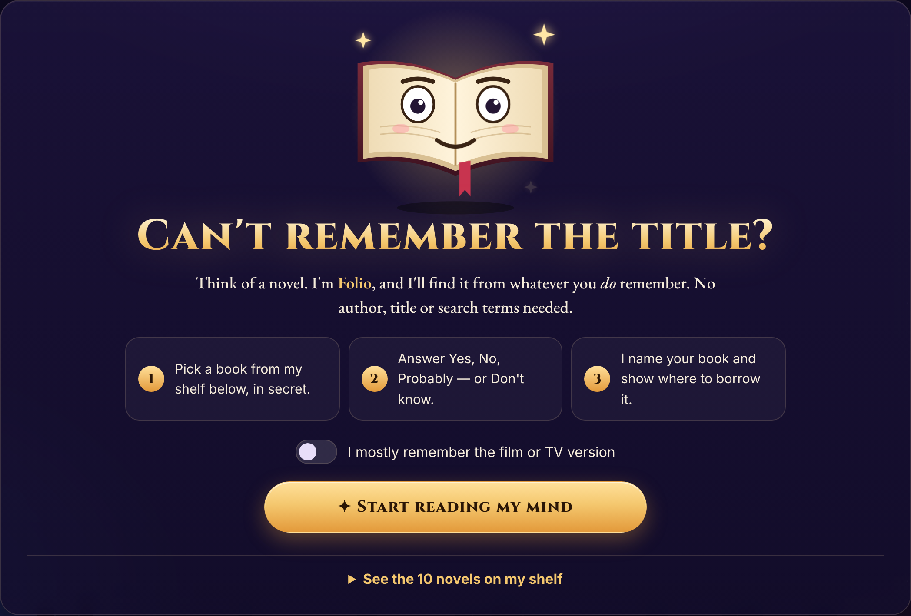

# Bookinator

*(project name during the hackathon: "That Book")*



**Remember the story. Forget the title.**

A reader half-remembers a novel. Bookinator's mascot **Folio**, an enchanted book, asks short questions (Yes / Probably / Don't know / Probably not / No), narrows down a fixed collection with a local Bayesian engine, proposes a best match with source-linked clues, and links to library catalogs. With an optional proxy, it also checks a library's holdings. Undo, wrong-guess recovery, a top-3 shortlist and an honest "not in this collection" exit are built in.

Theme: **Library + "Because I'm Lazy"**: the system chooses the search questions, so the reader doesn't need an author, title, ISBN or a good search query. There are no LLM calls during play.

> ⚠ **Current data is a 10-book DEVELOPMENT FIXTURE.** Labels were first written from general knowledge by an AI assistant. **171 of 589 labels were then checked against cited Wikipedia and Open Library pages** (status `supported`), and several guesses were corrected. 4 are marked `ambiguous` with notes; the rest are still unchecked. **No human has reviewed any of it.** The app shows a banner saying so, and clues show whether they're source-checked.

---

## Quick start

```bash
npm install
npm run dev            # http://localhost:5173
npm run verify         # type-check + all tests + catalog validation + Vite build (what CI runs)
npm test               # engine, simulator, availability and proxy tests (node:test via tsx)
npm run test:py        # data-pipeline, validator and HTTP-client tests (stdlib Python)
npm run simulate       # seeded simulations on the active catalog
npm run simulate:truth # simulations answering only from source-checked facts
npm run validate       # validate the fixture catalog against the data contract
npm run proxy          # optional Data4Library proxy (needs DATA4LIBRARY_AUTH_KEY)
npm run build          # production build into dist/ (static; works offline after load)
```

Requires Node 20+ and Python 3.10+. **CI** (`.github/workflows/ci.yml`) runs `npm install && npm run verify` on every push. **Deploy** (`deploy-pages.yml`, manual) publishes `dist/` to GitHub Pages; use that URL for the demo QR code.

A ready-made **offline single-file build** and a **labelled backup recording** are shipped alongside the zip.

### Optional library integrations (`.env.local`, see `.env.example`)

| Variable | Effect |
| --- | --- |
| `VITE_LOCAL_LIBRARY_SEARCH_URL` | A catalog search URL **you verified by hand**, with `{query}`. Uses the Korean title when known. |
| `VITE_LIBRARY_PROXY_URL`, `VITE_LIBRARY_CODE`, `VITE_LIBRARY_NAME` | Adds a "Check if [library] has it" button that calls `server/library-proxy.mjs`. Hidden unless all are set. |

The proxy keeps the Data4Library key **server-side**: `DATA4LIBRARY_AUTH_KEY=… npm run proxy`. It exposes `/health`, `/availability?isbn13=&libCode=` (bookExist) and `/libraries?isbn=&region=` (libSrchByBook). It validates inputs, times out after 6 s, and caches for 5 min. It returns `cached` and `fetchedAt`, so the UI never presents a cached result as live. Any failure (no key, upstream error, timeout, unexpected response) produces a message and the catalog link, never invented availability. The UI queries the book's **Korean edition ISBN** when one is stored and says exactly which edition it checked.

### Keyboard

`1`–`5` answer · `Y`/`N` on a guess · `U` undo · everything is a native button reachable with `Tab`. Focus moves to each new heading so screen readers announce it. The layout is a single column on phones, with a history sidebar from 860 px.

---

## Project layout

```
src/engine/            pure TypeScript shared by UI, tests and simulator
  model.ts  config.ts  posterior.ts  selectQuestion.ts  session.ts  explain.ts  links.ts
src/availability.ts    proxy client (never invents availability)
src/components/        start, question, history, guess, shortlist, found, no-match, availability
src/data/index.ts      the ONE line that chooses which catalog ships
src/data/fixture.catalog.json        generated 10-book fixture
server/library-proxy.mjs             optional Data4Library proxy (stdlib Node)
data/question_bank.json              64 questions, groups, recallability, flags
data/curation/fixture_labels.json    fixture labels + sources + which cells each source supports
data/curation/titles.csv             the 10 fixture books in pipeline format (real input)
data/evidence/<id>.json              per-book sources with paraphrased evidence notes
data/truth/fixture_supported_truth.json   truth set: only source-checked cells
scripts/build_fixture.py  validate_catalog.py  prepare_catalog.py  review.py
scripts/openlibrary_lookup.py  simulate.ts  prompts/matrix_prompt.txt
tests/  engine · simulate · availability · proxy (.test.ts) · pipeline · http_clients (test_*.py)
reports/                             latest simulation outputs
.github/workflows/                   ci.yml, deploy-pages.yml
```

---

## Engine (as specified)

- **Channel** (P(answer | fact Yes) / P(answer | fact No)):
  - Yes .55/.05 · Probably .20/.10 · Don't know .10/.10 · Probably not .10/.20 · No .05/.55.
  - Each column must sum to 1 and every entry must be > 0, or the engine refuses to load. So no normal answer can eliminate a book.
- **Likelihood:** `L = x·ch[a].yes + (1−x)·ch[a].no`. Unlabeled cells use x = 0.5.
- **Posterior:** replayed from a uniform prior in log space with a stable softmax. Rejected books get −∞. If nothing finite remains, the result is no-match.
- **Question selection:** maximize `IG × recallability` over active, unasked questions, at most one per correlation group. Adaptation-sensitive questions are skipped in film mode. Ties go to the earlier question. A test checks the optimized IG against the brief's direct formula.
- **Next action:**
  1. Two rejections → shortlist.
  2. Guess when there are ≥6 informative answers, top p ≥ 0.80, top/second ≥ 4, and ≥1 answer since the last rejection (the one addition to the brief; set `questionsAfterRejection = 0` to match the pseudocode literally).
  3. 18 questions asked, or no eligible questions → shortlist.
  4. Best score < 0.01 → shortlist.
  5. Otherwise ask.
- **Session:** an append-only event log, so Undo is exact, including un-rejecting a book.
- **Clues:** "Why this book" prefers source-checked labels and links the source. Unchecked labels are marked as such. No posterior percentages are shown.

---

## Data pipeline (Person B)

1. **Titles:** one row per work in `data/curation/titles.csv`. It already contains the 10 fixture books; extend it. Fill Korean titles, aliases, Open Library work IDs and ISBNs **only when verified**. `scripts/openlibrary_lookup.py` suggests work IDs for you to confirm.
2. **Evidence:** `data/evidence/<id>.json`, with real URLs, the license or terms, and an excerpt or paraphrased note. Check with `python3 scripts/prepare_catalog.py check`.
3. **Labelling:** `prepare_catalog.py label --dry-run`, then a 10-book pilot with `--model`, `--input-rate`, `--output-rate` and `--cap`.
   - Batches of 1–10 books; exact-ID, value and source checks.
   - Up to 3 retries; checkpoints; it stops *before* any call that could break the cap.
   - Works with Anthropic or OpenAI. Keys are read from the environment only.
4. **Merge:** `prepare_catalog.py merge --runtime-out src/data/catalog.json` validates, keeps earlier review decisions, and refuses to write a broken runtime file.
5. **Review:** `review.py export` covers demo books, 100 seeded random cells, and the separating cells of the closest pairs. Fill in verdicts, run `review.py apply`, then re-merge.
6. **Ship:** point `src/data/index.ts` at `./catalog.json`; use `merge --production` only after human review.

The validator checks:
- IDs and references; allowed probabilities and statuses;
- that supported cells cite their own book's sources;
- no placeholder URLs or licenses; Open Library ID format; **ISBN-13 checksums**;
- that edition ISBNs cite a source; no fixture labels in production;
- thinly labelled books, and book pairs the engine cannot separate.

---

## Verification results (14 Nov 2026, in the build environment)

| Check | Result |
| --- | --- |
| Full strict `tsc` incl. every React component, against **real `@types/react` 19** (fetched via git) | **pass** |
| Strict `tsc` on engine, scripts and tests (`tsconfig.engine.json`) | **pass** |
| `npm test`: engine, simulator, availability client, library proxy against a mock Data4Library | **49/49** |
| Python: validator, pipeline (mocked LLM), **HTTP clients against a local mock server** (Anthropic and OpenAI request formats, usage accounting, retry after HTTP 500, Open Library lookup with User-Agent, rate limit and cache) | **15/15** |
| `validate_catalog.py` on the fixture | **OK**, 0 errors, 0 warnings |
| `prepare_catalog.py check` and `label --dry-run` on the real 10-book inputs | **OK** |
| Chromium playtest at 390×844 and 1280×860, keyboard-driven: Undo, guess, two rejections → shortlist → no-match, reload-resume | **pass, no console errors** |
| Backup recording: real keyboard-driven game in Chromium (guesses *The Vegetarian* after 7 answers), captioned "RECORDED DEMO · not a live run" | **made** |

### Simulations (seed 42, 30 games × 10 books per scenario)

| Scenario | Top-1 (self-consistency) | Found incl. shortlist | Top-1 (crisp labels) | Top-1 (**only source-checked facts**) | Found incl. shortlist (source-checked) |
| --- | --- | --- | --- | --- | --- |
| clear | 92.7% (278/300) | 100% (300/300) | 100% (300/300) | 56.7% (170/300) | 88.7% (266/300) |
| half | 67.0% (201/300) | 96.0% (288/300) | 92.0% (276/300) | 24.0% (72/300) | 80.3% (241/300) |
| difficult | 34.3% (103/300) | 85.3% (256/300) | 63.0% (189/300) | 9.3% (28/300) | 69.3% (208/300) |
| one mistake | 76.0% (228/300) | 97.0% (291/300) | 100% (300/300) | 44.0% (132/300) | 81.0% (243/300) |

- **Self-consistency:** answers are drawn from the same labels the engine uses, and 0.7/0.3 labels count as false 30% of the time.
- **Crisp labels:** labels other than 0.5 are treated as certain.
- **Source-checked facts:** answers come only from the 171 source-checked cells; everything else is answered "Don't know". In that mode there was **1 wrong guess in 300 clear-memory games**: the engine stays cautious when evidence is thin. The low first-guess rate comes from having only 11–26 sourced facts per book out of 63 questions, so the 18-question budget runs out before it's confident.
- **Takeaway for the real catalog:** label coverage per book matters more than engine tuning. The `channel` scenario samples unknowns and is not comparable in truth mode; full outputs are in `reports/`.
- **Scale warning (synthetic random 200-book catalog, crisp truth):** clear top-1 was only 62.7%, needing about 16 questions. Measure the real catalog as soon as it loads. The levers are well-sourced 0.9/0.1 labels, sharper questions, a smaller demo pool, and channel tuning from playtests, not simply a lower guess threshold.

---

## Status of every item from the first handoff

| Item | Now |
| --- | --- |
| Vite never ran | **Resolved (14 Nov 2026).** Real `npm install` (vite 7.3.8, TypeScript 5.9.3, lockfile committed), `npm run verify` incl. `vite build`, and a Chromium playtest of `npm run dev` at phone and desktop size all pass. Python scripts now run through `scripts/py.mjs` so Windows without `python3` works (launcher not yet run on real Windows). |
| Fixture labels unchecked | **171/589 checked against cited sources**, several corrected (e.g. Darcy central, *1984* set in an imagined future, *The Vegetarian* film, *The Little Prince* TV series; *Orient Express* TV series downgraded). Korean titles for all 10, aliases (e.g. 상실의 시대), **8 Open Library work IDs**, **10 checksum-valid ISBNs** (6 Korean editions). **Still no human review.** |
| LLM labelling and Open Library lookup never executed | **Executed over HTTP against a mock server** with provider-shaped responses. A real call still needs a key and network: run a 1-book pilot first. |
| No live availability | **Built**: proxy + UI + tests. Data4Library has **not** been called with a real key; parameter names come from the API page as used by independent clients. Test with a key before the demo. |
| Backup recording | **Done** (MP4, labelled). Re-record once the real catalog is in. |
| QR code | Deploy workflow added; generate the QR from the Pages URL once deployed. |
| Human playtests, timed rehearsals | **Can't be done by me.** Recruit 10 fresh testers and record outcomes with exact denominators. |

## Research catalog (500 imported records → 17 playable books)

Two catalogs ship. The **10-book fixture** stays the default (`npm run dev`). The **CMU / research catalog**
is selected with `npm run dev:cmu` (or `VITE_CATALOG=cmu`). Never report imported records as game coverage:

| Measure (14 Nov 2026) | Count |
| --- | ---: |
| Source records imported (CMU Core priority 500) | 500 |
| Records with a validated question matrix | 500 (7,348 source-linked cells; 468 have ≥12) |
| Form holds kept out of the novel pool | 8 |
| Cells reviewed by a person | **0** |
| **Playable game targets** | **17** |

Pipeline (`npm run catalog:research`; needs the research and Core packs next to the repo, not committed):
1. `scripts/merge_research.py`: researched matrix (`core500_researched_labels.json`) merged by stable ID with
   this project's own 160 labelled books (`data/cmu/responses/`). 312 of our cells added where research had 0.5,
   none where research withheld or flagged a cell; 1 direction conflict (Water for Elephants q06) set to
   ambiguous; 497 agreeing cells keep the stronger value. **Calibration:** 3,200 cells whose recorded method is
   an explicit field or closed official list (language field, Nobel list, named series, corroborated publication
   period) go from qualified 0.7/0.3 to strong 0.9/0.1, as the labelling prompt's own scale defines. AI
   interpretations stay 0.7/0.3. The result passes the research pack's own `validate_evidence_matrix`.
2. `scripts/build_cmu_catalog.py --limit 500 --gate none`: compact runtime catalog, no plot text or quotes.
3. `scripts/gate_catalog.ts`: **engine gate** with the real engine and unchanged `config.ts` thresholds. A book
   is playable only if answering exactly from its own labels makes it the engine's first guess (backward seed,
   then forward retry in priority order). `tests/cmu_catalog.test.ts` re-checks this on every `npm test`.

Simulation of the 17 (`reports/simulation_research.json`, seed 42, 30 games/book): clear memory 26.3% first
guess, 92.7% found by any route (incl. shortlist); half memory 6.9% / 82.9%. Machine-labelled data: these are
not accuracy claims. Why so few: most research labels are qualified 0.7/0.3, which the engine cannot turn into a
confident guess within 18 questions. More playable books need **stronger, distinguishing plot labels reviewed by
a person**, not lower thresholds. Every book's status and reason is in `data/cmu/coverage_report.json`.

## Front end: Folio and the night library

The interface is an original Akinator-style game: **Folio**, an enchanted open book drawn in SVG
(`src/components/Folio.tsx`), floats in a candle-lit night library and changes expression with the game
state: curious on early questions, thinking later on, puzzled after "Don't know" or at the shortlist,
confident when guessing, triumphant when the book is found, sad on no match. Its mood never reflects the
posterior. Questions appear in a parchment speech bubble; answers are five glowing buttons (keys 1–5);
books get generated leather covers (no cover images: their rights are not established) with a flip-in
reveal. Everything is CSS and inline SVG; animation stops under `prefers-reduced-motion`.

## ChatGPT's research source code

`research/chatgpt_source/` holds the source code used for the 500-book research pass (labelling, source
parsing, enrichment, validation, the five-book demo) exactly as supplied, with its own README and
attribution. Its 31 + 8 Python tests and the demo checks run in `npm run verify` (`npm run test:research`).
Its large data directories are not committed; see the research catalog section above.

## Limitations

- The catalog is still a 10-book fixture; the 200-book catalog needs Person B's sourcing and human review.
- "Source-checked" means an AI assistant read the cited page; treat it as a strong first pass, not review.
- Simulations are stress scenarios, not human behavior.
- `q56` (short novel) stays inactive until "short" is defined. Adaptation-sensitive flags are a judgment call.
- Not built, per the brief: accounts, online learning, vector search, live LLM, covers, related books.
